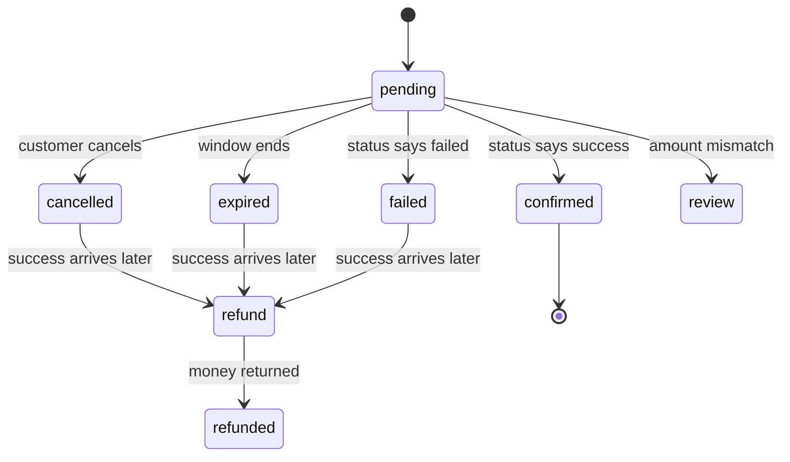

# How Best to Setup Paychangu Direct Charge

How to collect mobile money and bank transfer payments from your own screens, with Paychangu doing the money movement and your server staying in charge of what counts as paid. It is written to be dropped into any client site: Next.js, TypeScript and a Neon (Postgres) database. Every amount is in Malawi Kwacha.

## The one idea worth understanding before writing any code

Direct Charge takes the browser out of the payment. Your server starts a charge. The customer finishes it somewhere else: on their phone for mobile money, in their banking app for a bank transfer. Nothing about the outcome ever travels through the customer's browser, so there is no redirect to break and no page that can show a wrong status.

The price is that **the only way you ever learn the outcome is by asking Paychangu**. That gives the whole design its rules:

1. **Only a status check that says `success` means paid.** Not the "accepted" response from starting the charge, not a message on a screen, not a webhook on its own.
2. **Your waiting window ends the customer's wait, not your checking.** You cannot recall a PIN prompt or a bank account number once it has been issued. A customer can still approve after your window closes, so expired payments keep being checked, and a late success is recorded and refunded.
3. **An error never changes state.** A timeout, a 5xx or a 429 means you learned nothing. You try again later.
4. **Customers never see Paychangu's messages.** Anything that comes from Paychangu is logged for you and replaced by a generic message for them.

Webhooks, if you add them later, are a bonus on top. Everything here works with status checks alone.

## How a payment moves

**Mobile money (Airtel Money or TNM Mpamba)**

1. The customer enters a phone number. Your site works out the network from the number and checks any network choice matches.
2. Your server saves a payment row, then asks Paychangu to send a PIN prompt. A "success" here means the request was accepted. The prompt reaches the phone in about 10 to 15 seconds.
3. The customer has **5 minutes**. Your server checks the status every few seconds while they wait.
4. Paychangu reports `success` (confirmed), `failed` (wrong PIN, no funds, declined), or keeps saying `pending`.
5. If the 5 minutes pass, or the customer cancels, the payment is marked `expired` and the payable is released. Checking continues in the background.

**Bank transfer**

1. Your server saves a payment row, then asks Paychangu for a one-off bank account for this charge. There is no phone number and no operator step.
2. Your screen shows the bank, account name, account number and the exact amount.
3. The customer has **10 minutes**, an "I've paid" button that triggers a check, and a Cancel button.
4. The customer sends the money from their banking app. Paychangu reports `success` when it arrives.
5. After 10 minutes, or on cancel, the payment is `expired` and checking continues in the background.

### Payable statuses

The "payable" is whatever is being paid for. On a real site that is your `bookings`, `orders` or `donations` table. Use your own wording for `confirmed` (paid, booked, completed), but keep the meanings.

| Status | Meaning |
|---|---|
| `pending` | Waiting for payment. Stock, slot or seat is held |
| `confirmed` | Verified paid. Deliver |
| `cancelled` | The customer cancelled |
| `expired` | The waiting window ended |
| `failed` | Paychangu said the payment failed |
| `refund` | Money arrived for a payable that was already closed. You owe a refund |
| `refunded` | You returned the money |
| `review` | The amount received does not match the amount due. A person decides |

**Held means `pending` and not past `expires_at`.** Whenever you count what is held (slots, seats, stock), treat a `pending` payable whose `expires_at` has passed as free, even if nothing has marked it `expired` yet. That keeps availability correct when background sweeps are infrequent or absent.



### Payment statuses

The `payments` table records what Paychangu said, plus your own `expired`.

| Status | Meaning | Still checked? |
|---|---|---|
| `pending` | Customer is inside the window | Yes |
| `expired` | You stopped waiting (window ended or cancel). Paychangu has not given a final answer | **Yes** |
| `success` | Verified paid | No |
| `failed` | Paychangu said failed | No |
| `review` | Verified success, wrong amount | No (manual) |

`expired` must never mean "stopped checking". If it did, a late payment would go unnoticed.

## Environment variables and constants

```env
PAYCHANGU_SECRET_KEY=
DATABASE_URL=
CRON_SECRET=
```

`PAYCHANGU_SECRET_KEY` is the only Paychangu secret. Use a test or live key to match the environment, and keep it server-side only. `DATABASE_URL` is your Neon connection string (use the pooled one on serverless hosts). `CRON_SECRET` is only needed if you run the background sweep from a scheduler or an admin route (see "Scheduling the background job"). On Vercel, set it as an environment variable and Vercel's own cron calls send it automatically. Add `PAYCHANGU_WEBHOOK_SECRET` only if you add webhooks.

Keep the tunable numbers as named constants, not scattered values:

| Constant | Value |
|---|---|
| Waiting window, mobile money | 5 minutes |
| Waiting window, bank transfer | 10 minutes |
| Tracking window (how long expired payments keep being checked) | 24 hours, counted from the payment's `created_at` (48 hours if a daily cron is your only scheduler) |
| Customer polling | every 5 seconds for 2 minutes, then every 10 seconds |
| Minimum gap between Paychangu calls for one charge | 4 seconds |
| Fixed amount (fixed-price sites only) | `FIXED_AMOUNT_MWK` |
| Background sweep | optional, see "Scheduling the background job" |

Paychangu limits how many requests you can make in a window (about 100, and its responses show how many you have left). Polling is the main thing that uses it: one waiting customer at a 5-second interval is 12 calls a minute. That is why the server never calls Paychangu more than once per charge in any 4-second span, however many browsers are polling.

## The database

Two tables. Your own payable table gets a few extra columns, and `payments` is the same on every site.

### Your payable table

Add these to your orders, bookings or donations table (or create it with them):

```sql
CREATE TABLE bookings (               -- rename: orders, donations, ...
  id            uuid PRIMARY KEY DEFAULT gen_random_uuid(),
  reference     text NOT NULL UNIQUE,                  -- what the customer sees: KAN15181
  status        text NOT NULL DEFAULT 'pending',       -- values above
  amount        integer,                               -- kwacha; leave empty on fixed-price sites
  expires_at    timestamptz,                           -- end of the customer's wait
  paid_at       timestamptz,
  customer_name   text,
  customer_mobile text,
  customer_email  text,
  -- ...your own columns: services, slot, items, ...
  created_at    timestamptz NOT NULL DEFAULT now()
);
```

- `id` (UUID) goes in links and foreign keys. `reference` is for display and search only. A short reference can be guessed, so never use it as a secret.
- **Amount is optional.** Sites with variable prices set `amount` from their own prices on the server, never from the browser. Fixed-price sites leave it empty and set `FIXED_AMOUNT_MWK` in code. The status check compares against whichever applies. If you change a fixed price later, remember that old late payments will then be compared with the new price, so store the amount on the payable if prices change often.
- Email and names are optional for Paychangu. Collect them anyway where you can. For bank transfers they may be the only thing that identifies a customer besides the reference, so always show the reference on screen.
- Generate `reference` randomly with the unique index as the guard: if an insert collides, generate another and try again. A database sequence avoids collisions entirely.

### `payments`

```sql
CREATE TABLE payments (
  id                text PRIMARY KEY,           -- the charge ID, e.g. airtel-7k3q92xd4m
  payable_id        uuid NOT NULL UNIQUE REFERENCES bookings(id),
  payable_reference text NOT NULL,              -- copy, for search
  customer_name     text,                       -- copy
  method            text NOT NULL CHECK (method IN ('airtel_money','tnm_mpamba','bank_transfer')),
  mobile            text,                       -- your normalised copy (mobile money only)
  status            text NOT NULL DEFAULT 'pending'
                    CHECK (status IN ('pending','expired','success','failed','review')),
  ids               jsonb,                      -- {"ref": ..., "trace": ..., "receipt": ...}
  bank_details      jsonb,                      -- {"bank": ..., "name": ..., "number": ...}
  note              text,                       -- the last problem, in plain words
  last_verified_at  timestamptz,
  finalized_at      timestamptz,                -- optional
  created_at        timestamptz NOT NULL DEFAULT now()
);

CREATE INDEX payments_open_idx ON payments (status, created_at)
  WHERE status IN ('pending','expired');
```

### Where each value comes from

| Column | Holds | Comes from |
|---|---|---|
| `id` | The charge ID | Generated by your server (see "Charge IDs") |
| `payable_id` | Link to the booking, order or donation | Your payable |
| `payable_reference`, `customer_name` | Copies for support search | Your payable |
| `method` | `airtel_money`, `tnm_mpamba` or `bank_transfer` | Your form: the bank choice, or the number's prefix |
| `mobile` | The normalised number | Your form, after your phone helper |
| `status` | `pending`, `expired`, `success`, `failed`, `review` | Your `settle` logic, from what Paychangu says |
| `ids` | `ref` and `trace`: what Paychangu quotes in support. `receipt`: the operator's transaction ID or the bank's receipt number | `ref` and `trace` from Paychangu's response when the charge starts. `receipt` from the status check on success |
| `bank_details` | Bank, account name and account number to show the customer | Paychangu's response when the bank charge starts |
| `note` | The last problem: a start error, a failed call, the failure log line, or an amount mismatch | Written by your code when something goes wrong |
| `last_verified_at` | The last time a status check succeeded | Your server's clock |
| `finalized_at` | When the payment ended | Paychangu's `completed_at` on success, or its last log time on failure |
| `created_at` | When your row was inserted, just before Paychangu was called | The database clock |

### The timestamps

| Field | Meaning | Needed? |
|---|---|---|
| `payments.created_at` | When the attempt began. The tracking window counts from here | Yes |
| `payments.last_verified_at` | The last good answer from Paychangu. It enforces the 4-second gap and tells the sweep what is due | Yes |
| `payments.finalized_at` | When the payment actually ended. Useful for measuring how long customers take to pay, which is how you tune the 5 and 10-minute windows | Optional. Drop it if you do not need that, since `paid_at` on the payable already says when it was paid |
| `payable.expires_at` | End of the customer's wait. Set when Paychangu accepts the charge | Yes |
| `payable.paid_at` | When your system confirmed the payment | Yes |

### What is not stored, and why

- **The fee.** Paychangu charges a percentage, so it can be worked out from its published rates, or read from a charge on demand. Do not recompute old payments with a new rate.
- **The operator name.** It is in `method`.
- **The operator's UUID, Paychangu's own transaction UUID, and the currency.** The first is looked up from the operator list, the second adds nothing for support beyond `ref` and `trace`, and every amount is kwacha.
- **Full response bodies and the bank account's own expiry.** Ask Paychangu when you need the full picture of a charge (the support screen's refresh does this). Your 10-minute window comes from the payable's `expires_at`, not from the bank's.
- **A tracking deadline.** It is `created_at` plus 24 hours, worked out in the query.
- **The payer's name and account number on a paid bank transfer.** The code never stores them.

### Notes on the design

- **`payable_id UNIQUE`** means one payable has one payment. A retry is a new payable and a new payment. It also stops a double click from creating two payments for the same payable.
- **Keep your own copy of the phone number.** Do not rely on getting it back from Paychangu.
- **Bank account details are saved when the charge starts.** They stop being returned once the transfer is paid.
- **`note` does two jobs** (the last failed call and the failure reason) because only the latest problem matters.

### Naming

Tables and columns are `snake_case`. Money is an integer number of kwacha, never a float. Timestamps end in `_at`, are timezone-aware and stored in UTC. Method values are `airtel_money`, `tnm_mpamba` and `bank_transfer`.

### Neon notes

- Use the pooled connection string on serverless hosts.
- Each query through Neon's HTTP driver is its own request, so anything that must happen together is written as one SQL statement (the examples below use a CTE for this). That also makes the status updates safe when two requests settle the same payment at once.
- `gen_random_uuid()`, `jsonb`, partial indexes and `make_interval` all work as written. JSON values are passed as `JSON.stringify(...)` with a `::jsonb` cast.

## How a payment moves through the database

| Step | What happens | What is written, and from where |
|---|---|---|
| 0 | The customer reaches the payment step | Your payable already exists: `status = pending`, a `reference`, and an `amount` (or none on a fixed-price site) |
| 1 | The customer chooses bank, or enters a number | Nothing is saved. Your code works out `method`: `bank_transfer`, or from the number's prefix (09 is `airtel_money`, 08 is `tnm_mpamba`) |
| 2 | Your server inserts the payment **before** calling Paychangu | `id`: generated. `payable_id`, `payable_reference`, `customer_name`: copied from the payable. `method`, `mobile`: from step 1. `status = pending`. `created_at`: the database clock. The payable gets a provisional `expires_at` |
| 3 | Paychangu is asked to start the charge | Nothing is stored while waiting |
| 4a | Paychangu accepts | `ids.ref` and `ids.trace` from its response, and `bank_details` for a bank transfer. The payable's `expires_at` is reset to now plus 5 or 10 minutes |
| 4b | Paychangu rejects, or cannot be reached | `status = failed`, `note` = the error text. The payable becomes `failed`. The customer sees the generic message |
| 5 | The customer waits, and the page polls your server | If the last good check was more than 4 seconds ago, your server asks Paychangu and sets `last_verified_at`. Still pending: nothing else changes |
| 6a | Paychangu says `success` | `status = success`, `ids.receipt`, `finalized_at`. The payable becomes `confirmed` with `paid_at`, or `refund` if it completed after the window |
| 6b | Paychangu says `failed` | `status = failed`, `note` = its last log line, `finalized_at`. The payable becomes `failed` |
| 6c | The amount is wrong | `status = review`, `note` = "Expected X, got Y". The payable becomes `review` |
| 7 | The customer cancels, or the window passes | The payment becomes `expired`, the payable becomes `cancelled` or `expired`. The payment is still checked afterwards |
| 8 | A sweep runs (if you use one) | Picks payments that are `pending` or `expired`, created within the last 24 hours and not checked recently, and runs steps 5 and 6 for each |
| 9 | You refund a payable in `refund` | You set the payable to `refunded` |

## Charge IDs

Your server generates the charge ID, and saves the payment row **before** calling Paychangu. Every attempt gets a new one, and a reused ID is rejected.

```
airtel-7k3q92xd4m
tnm-4h8wn2tq6c
bank-9d2fm5xr8b
```

A prefix for the method (`airtel`, `tnm`, `bank`) plus 10 random characters, all lowercase, from an alphabet with no look-alike characters. The prefix makes a charge recognisable in Paychangu's dashboard and in support conversations. Your code still reads the `method` column to decide which endpoint to call, never the prefix. The primary key is the unique index; on the rare collision, generate another ID and retry.

The charge ID is not your ticket, order or receipt number. Customers see the payable's `reference`.

## Before you initiate

Do all of this before calling Paychangu. Almost every error on starting a charge is avoidable, and those that are not should never reach the customer as Paychangu's wording.

**All methods**

- The secret key is set and healthy (key check below).
- The amount is a positive integer: the payable's `amount`, or `FIXED_AMOUNT_MWK`. Never taken from the browser.
- The payable exists, is `pending`, and has no payment yet.
- A double submit cannot create two payables (see "Double-submit protection" under optional extras).
- The charge ID is generated and the payment row is saved first.

**Mobile money**

- The operator list is loaded and cached.
- The phone number is normalised in one helper.
- The number's prefix matches the operator. This is not optional: Paychangu accepts a request where the number belongs to a different network, then the operator refuses it. Nothing tells you at the time, and the customer waits for a prompt that never comes.

**Bank transfer**

- Nothing about the phone. Decide how you will identify the customer (reference on screen, plus name or email if you have them).

**Key check.** A bad secret key is the most embarrassing failure, because every payment on the site fails. Check it at deploy time and on an admin page: ask for the status of a charge that does not exist. A good key answers "not found" (404), a bad key answers "forbidden" (403). Alert yourself on the second.

## `lib/paychangu-direct.ts`

Everything that talks to Paychangu lives in one file, so nothing else needs to know its response shapes.

```typescript
// lib/paychangu-direct.ts
import { randomInt } from "crypto";

const BASE_URL = "https://api.paychangu.com";

export type Method = "airtel_money" | "tnm_mpamba" | "bank_transfer";
export const isBank = (m: Method) => m === "bank_transfer";
export const holdMinutes = (m: Method) => (isBank(m) ? 10 : 5);
export const TRACK_HOURS = 24; // use 48 if a daily cron is your only scheduler

const CHARGE_PREFIX: Record<Method, string> = { airtel_money: "airtel", tnm_mpamba: "tnm", bank_transfer: "bank" };

// ---------- one fetch wrapper: timeout, never throws on HTTP errors ----------
type ApiResponse = { http: number; body: any }; // http 0 = network error or timeout

async function call(path: string, init: { method?: string; json?: unknown } = {}): Promise<ApiResponse> {
  const key = process.env.PAYCHANGU_SECRET_KEY;
  if (!key) throw new Error("PAYCHANGU_SECRET_KEY is not set");
  const controller = new AbortController();
  const timer = setTimeout(() => controller.abort(), 15_000);
  try {
    const res = await fetch(BASE_URL + path, {
      method: init.method ?? "GET",
      headers: {
        Accept: "application/json",
        "Content-Type": "application/json",
        Authorization: `Bearer ${key}`,
      },
      body: init.json ? JSON.stringify(init.json) : undefined,
      signal: controller.signal,
      cache: "no-store",
    });
    const body = await res.json().catch(() => null);
    return { http: res.status, body };
  } catch {
    return { http: 0, body: null };
  } finally {
    clearTimeout(timer);
  }
}

export type ErrorKind = "auth" | "rate_limited" | "server" | "network" | "not_found" | "rejected";

function errorKind(http: number): ErrorKind {
  if (http === 0) return "network";
  if (http === 401 || http === 403) return "auth";
  if (http === 404) return "not_found";
  if (http === 429) return "rate_limited";
  if (http >= 500) return "server";
  return "rejected"; // 400 and anything unexpected
}

// Paychangu's "message" is sometimes a string, sometimes an object keyed by field.
function flatten(message: unknown): string {
  return typeof message === "string" ? message : JSON.stringify(message ?? "");
}

// ---------- key check ----------
export async function checkSecretKey(): Promise<"ok" | "bad_key" | "unreachable"> {
  const r = await call("/mobile-money/payments/key-check-0000/verify");
  if (r.http === 404) return "ok"; // a good key says "no such charge"
  if (r.http === 401 || r.http === 403) return "bad_key";
  return "unreachable";
}

// ---------- operators (mobile money only) ----------
export interface Operator { name: string; ref_id: string; short_code: string }
let operatorCache: { at: number; list: Operator[] } | null = null;

export async function getOperatorRefId(shortCode: "airtel" | "tnm"): Promise<string | null> {
  if (!operatorCache || Date.now() - operatorCache.at > 6 * 3_600_000) {
    const r = await call("/mobile-money");
    if (r.http === 200 && Array.isArray(r.body?.data)) {
      operatorCache = { at: Date.now(), list: r.body.data };
    } // on failure keep serving the old list
  }
  return operatorCache?.list.find((o) => o.short_code === shortCode)?.ref_id ?? null;
}

// ---------- phone numbers ----------
export function parseMalawiNumber(input: string) {
  let d = input.replace(/[\s()-]/g, "");
  if (d.startsWith("+265")) d = d.slice(4);
  else if (d.startsWith("265") && d.length === 12) d = d.slice(3);
  if (d.startsWith("0")) d = d.slice(1);
  if (!/^[89]\d{8}$/.test(d)) return null;
  // 09... is Airtel, 08... is TNM. Confirm the ranges if a network adds new prefixes.
  const network = d.startsWith("9") ? ("airtel" as const) : ("tnm" as const);
  const method: Method = network === "airtel" ? "airtel_money" : "tnm_mpamba";
  return { local: "0" + d, network, method };
}

// ---------- charge IDs ----------
const ALPHABET = "23456789abcdefghjkmnpqrstuvwxyz"; // no 0 o 1 l i
export function newChargeId(method: Method): string {
  let s = "";
  for (let i = 0; i < 10; i++) s += ALPHABET[randomInt(ALPHABET.length)];
  return `${CHARGE_PREFIX[method]}-${s}`;
}

// ---------- starting a charge ----------
export type InitiateOutcome =
  | {
      outcome: "accepted";
      refId: string | null;
      traceId: string | null;
      account?: { bank: string; name: string; number: string }; // bank transfer only
    }
  // "unknown" = timeout or 5xx: the request may or may not have got through
  | { outcome: "rejected" | "auth" | "rate_limited" | "unknown"; message: string };

function initiateFailure(r: ApiResponse): InitiateOutcome {
  const kind = errorKind(r.http);
  const message = flatten(r.body?.message) || `HTTP ${r.http}`;
  if (kind === "auth") return { outcome: "auth", message };
  if (kind === "rate_limited") return { outcome: "rate_limited", message };
  if (kind === "network" || kind === "server") return { outcome: "unknown", message };
  return { outcome: "rejected", message };
}

interface Customer { email?: string; firstName?: string; lastName?: string }

export async function initiateMobileMoney(p: Customer & {
  chargeId: string; mobileLocal: string; operatorRefId: string; amount: number;
}): Promise<InitiateOutcome> {
  const r = await call("/mobile-money/payments/initialize", {
    method: "POST",
    json: {
      mobile: p.mobileLocal,
      mobile_money_operator_ref_id: p.operatorRefId,
      amount: String(p.amount), // sent as a string
      charge_id: p.chargeId,
      email: p.email,
      first_name: p.firstName,
      last_name: p.lastName,
    },
  });
  const d = r.body?.data;
  if (r.http === 200 && d?.charge_id) {
    return { outcome: "accepted", refId: d.ref_id ?? null, traceId: d.trace_id ?? null };
  }
  return initiateFailure(r);
}

export async function initiateBankTransfer(p: Customer & {
  chargeId: string; amount: number; mobile?: string;
}): Promise<InitiateOutcome> {
  const r = await call("/direct-charge/payments/initialize", {
    method: "POST",
    json: {
      amount: String(p.amount),
      currency: "MWK",
      payment_method: "mobile_bank_transfer",
      charge_id: p.chargeId,
      email: p.email,
      first_name: p.firstName,
      last_name: p.lastName,
      mobile: p.mobile,
    },
  });
  const t = r.body?.data?.transaction;          // bank responses nest the charge under "transaction"
  const a = r.body?.data?.payment_account_details;
  if (r.http === 200 && t && a?.account_number) {
    return {
      outcome: "accepted",
      refId: t.ref_id ?? null,
      traceId: t.trace_id ?? null,
      account: { bank: a.bank_name, name: a.account_name, number: a.account_number },
    };
  }
  return initiateFailure(r);
}

// ---------- checking a charge ----------
export type ChargeState = "success" | "failed" | "pending" | "unknown";

export type StatusResult =
  | {
      ok: true;
      state: ChargeState;
      amount: number | null;
      completedAt: string | null;
      lastLog: string | null;
      lastLogAt: string | null;
      receipt: string | null; // the operator's transaction ID or the bank's receipt number
      raw: unknown;
    }
  | { ok: false; http: number; kind: ErrorKind; message: string };

const FAILED = new Set(["failed", "declined", "timed_out", "cancelled", "expired", "insufficient_funds"]);

function classify(status: unknown): ChargeState {
  const v = String(status ?? "").toLowerCase();
  if (v === "success") return "success";
  if (v === "pending") return "pending";
  return FAILED.has(v) ? "failed" : "unknown"; // anything else is unknown, never assumed
}

export async function getChargeStatus(method: Method, chargeId: string): Promise<StatusResult> {
  const id = encodeURIComponent(chargeId);
  // Mobile money and bank transfer use different endpoints. Mixing them up returns errors.
  const r = await call(
    isBank(method)
      ? `/direct-charge/transactions/${id}/details`
      : `/mobile-money/payments/${id}/verify`,
  );
  const t = isBank(method) ? r.body?.data?.transaction : r.body?.data;

  // Read the HTTP status first. The "status" word at the top of an error body can say
  // "failed" or "pending" and means nothing about the payment.
  if (r.http !== 200 || !t) {
    return { ok: false, http: r.http, kind: errorKind(r.http), message: flatten(r.body?.message) };
  }

  const logs: Array<{ message: string; created_at: string }> = Array.isArray(t.logs) ? t.logs : [];
  const last = logs[logs.length - 1];
  return {
    ok: true,
    state: classify(t.status),                  // the payment's own status, never the top-level one
    amount: t.amount != null ? Number(t.amount) : null,
    completedAt: t.completed_at ?? null,        // empty on failures; use lastLogAt for those
    lastLog: last?.message ?? null,             // for staff, never for customers or code
    lastLogAt: last?.created_at ?? null,
    receipt: t.authorization?.mobile_money_trans_id ?? t.authorization?.payer_bank_receipt_number ?? null,
    raw: r.body,
  };
}
```

## `lib/payments.ts`

This is the payment logic: starting, settling, cancelling and the background sweep. Replace `bookings` with your payable table, and adjust the column names you read from it.

```typescript
// lib/payments.ts
import { neon } from "@neondatabase/serverless";
import {
  Method, TRACK_HOURS, getChargeStatus, getOperatorRefId, holdMinutes, initiateBankTransfer,
  initiateMobileMoney, InitiateOutcome, isBank, newChargeId, parseMalawiNumber,
} from "./paychangu-direct";

const sql = neon(process.env.DATABASE_URL!);
const sleep = (ms: number) => new Promise((r) => setTimeout(r, ms));

// Fixed-price sites: set this and leave bookings.amount empty. Variable-price sites: leave null.
export const FIXED_AMOUNT_MWK: number | null = null;

export function alertOps(message: string) {
  console.error("[payments]", message); // also send to email, Slack, or your logger
}

export const GENERIC_START_ERROR = "We couldn't start your payment. Please try again in a moment.";

// ======================= START =======================

export interface StartInput {
  payableId: string;
  channel: "mobile" | "bank";
  mobile?: string;                  // mobile money only
  network?: "airtel" | "tnm";       // optional: if your form asks, it must match the number
  email?: string; firstName?: string; lastName?: string;
}

export type StartResult =
  | { ok: true; chargeId: string; method: Method; expiresAt: string;
      account?: { bank: string; name: string; number: string } }
  | { ok: false; message: string };   // safe to show to the customer

export async function startPayment(input: StartInput): Promise<StartResult> {
  const [payable] = await sql`
    SELECT id, reference, status, amount, customer_name FROM bookings WHERE id = ${input.payableId}`;
  if (!payable || payable.status !== "pending") return { ok: false, message: "This order is no longer open." };

  const amount: number | null = payable.amount ?? FIXED_AMOUNT_MWK;
  if (!amount || amount <= 0) {
    alertOps("No amount: set bookings.amount or FIXED_AMOUNT_MWK");
    return { ok: false, message: GENERIC_START_ERROR };
  }

  // ---- 1. Pre-flight. These messages are yours, so they can be specific. ----
  let method: Method = "bank_transfer";
  let local: string | null = null;
  let operatorRefId: string | null = null;
  if (input.channel === "mobile") {
    const phone = input.mobile ? parseMalawiNumber(input.mobile) : null;
    if (!phone) return { ok: false, message: "Enter a valid Airtel or TNM number." };
    if (input.network && input.network !== phone.network) {
      return { ok: false, message: `That number does not look like a ${input.network === "airtel" ? "Airtel" : "TNM"} number.` };
    }
    method = phone.method;
    local = phone.local;
    operatorRefId = await getOperatorRefId(phone.network);
    if (!operatorRefId) {
      alertOps("Mobile money operator list unavailable");
      return { ok: false, message: GENERIC_START_ERROR };
    }
  }

  // ---- 2. Save the payment BEFORE calling Paychangu ----
  const holdSeconds = holdMinutes(method) * 60;
  let chargeId = "";
  for (let attempt = 0; attempt < 3 && !chargeId; attempt++) {
    const id = newChargeId(method);
    const rows = await sql`
      INSERT INTO payments (id, payable_id, payable_reference, customer_name, method, mobile)
      VALUES (${id}, ${payable.id}, ${payable.reference}, ${payable.customer_name}, ${method}, ${local})
      ON CONFLICT DO NOTHING
      RETURNING id`;
    if (rows.length) { chargeId = id; break; }
    const [existing] = await sql`SELECT id FROM payments WHERE payable_id = ${payable.id}`;
    if (existing) return { ok: false, message: "A payment is already in progress for this order." };
    // otherwise the random ID collided: loop and generate another
  }
  if (!chargeId) return { ok: false, message: GENERIC_START_ERROR };

  // Provisional deadline, reset when Paychangu accepts the charge
  await sql`UPDATE bookings SET expires_at = now() + make_interval(secs => ${holdSeconds + 30}) WHERE id = ${payable.id}`;

  // ---- 3. Start the charge ----
  const customer = { email: input.email, firstName: input.firstName, lastName: input.lastName };
  const initiate = (): Promise<InitiateOutcome> =>
    isBank(method)
      ? initiateBankTransfer({ chargeId, amount, mobile: input.mobile, ...customer })
      : initiateMobileMoney({ chargeId, mobileLocal: local!, operatorRefId: operatorRefId!, amount, ...customer });

  let res = await initiate();
  if (res.outcome === "rate_limited") { await sleep(3000); res = await initiate(); } // retry once

  // A timeout or 5xx does not prove nothing was sent.
  if (res.outcome === "unknown" && !isBank(method)) {
    for (let i = 0; i < 2; i++) {
      await sleep(4000);
      const s = await getChargeStatus(method, chargeId);
      if (s.ok) { res = { outcome: "accepted", refId: null, traceId: null }; break; }
      if (s.kind === "not_found") break; // never created: leave res as "unknown", treated as failed below
    }
  }
  // (Bank: if the response was lost, the account number was lost with it. Treat as failed.)

  // ---- 4. Apply the result ----
  if (res.outcome === "accepted") {
    const ids = JSON.stringify({ ref: res.refId, trace: res.traceId });
    const bank = res.account ? JSON.stringify(res.account) : null;
    await sql`UPDATE payments SET ids = ${ids}::jsonb, bank_details = ${bank}::jsonb WHERE id = ${chargeId}`;
    // the customer's clock starts now
    await sql`UPDATE bookings SET expires_at = now() + make_interval(secs => ${holdSeconds}) WHERE id = ${payable.id}`;
    const [b] = await sql`SELECT expires_at FROM bookings WHERE id = ${payable.id}`;
    return { ok: true, chargeId, method, expiresAt: new Date(b.expires_at).toISOString(), account: res.account };
  }

  // Anything else: log the real reason, show the customer a generic one.
  await sql`
    WITH hit AS (UPDATE payments SET status = 'failed', note = ${res.message} WHERE id = ${chargeId} RETURNING payable_id)
    UPDATE bookings SET status = 'failed' FROM hit WHERE bookings.id = hit.payable_id AND bookings.status = 'pending'`;
  alertOps(`Could not start ${chargeId} (${res.outcome}): ${res.message}`);
  return { ok: false, message: GENERIC_START_ERROR };
}

// ======================= SETTLE =======================
// The only place that decides what a status check means. The customer's polling,
// the background sweep and any future webhook all call this.

export async function settle(paymentId: string): Promise<void> {
  const [p] = await sql`
    SELECT p.id, p.method, p.status AS pay_status, b.status AS payable_status, b.expires_at, b.amount AS payable_amount
      FROM payments p JOIN bookings b ON b.id = p.payable_id
     WHERE p.id = ${paymentId}`;
  if (!p || !["pending", "expired"].includes(p.pay_status)) return; // already final

  const s = await getChargeStatus(p.method, p.id);

  // An error never changes state.
  if (!s.ok) {
    await sql`UPDATE payments SET note = ${`HTTP ${s.http}: ${s.message || s.kind}`} WHERE id = ${p.id}`;
    if (s.kind === "auth") alertOps("Paychangu rejected the secret key. Every payment looks unpaid until this is fixed.");
    return;
  }
  await sql`UPDATE payments SET last_verified_at = now(), note = NULL WHERE id = ${p.id}`;

  if (s.state === "unknown") {
    alertOps(`Unrecognised status for ${p.id}: ${JSON.stringify(s.raw)}`);
    return; // treated as pending
  }

  if (s.state === "pending") {
    // Expire only after a check that actually said "pending", so an outage never expires a paid order.
    if (p.payable_status === "pending" && new Date(p.expires_at) <= new Date()) await expire(p.id);
    return;
  }

  if (s.state === "failed") {
    await sql`
      WITH hit AS (
        UPDATE payments SET status = 'failed', note = ${s.lastLog}, finalized_at = ${s.lastLogAt}
         WHERE id = ${p.id} AND status IN ('pending','expired') RETURNING payable_id)
      UPDATE bookings SET status = 'failed' FROM hit WHERE bookings.id = hit.payable_id AND bookings.status = 'pending'`;
    return;
  }

  // ---- success ----
  const expected: number | null = p.payable_amount ?? FIXED_AMOUNT_MWK;
  if (expected == null || s.amount !== expected) {
    const detail = `Expected ${expected}, got ${s.amount}`;
    await sql`
      WITH hit AS (
        UPDATE payments SET status = 'review', note = ${detail}, finalized_at = ${s.completedAt}
         WHERE id = ${p.id} AND status IN ('pending','expired') RETURNING payable_id)
      UPDATE bookings SET status = 'review' FROM hit WHERE bookings.id = hit.payable_id`;
    alertOps(`Amount problem on ${p.id}: ${detail}`);
    return;
  }

  // One statement: only the caller that flips the payment also moves the payable.
  // Confirm only if the payment completed inside the customer's window. Otherwise it is a
  // late payment (refund), even if nothing has marked the payable expired yet.
  const done = await sql`
    WITH won AS (
      UPDATE payments SET status = 'success', finalized_at = ${s.completedAt},
             ids = COALESCE(ids, '{}'::jsonb) || jsonb_build_object('receipt', ${s.receipt}::text)
       WHERE id = ${p.id} AND status IN ('pending','expired') RETURNING payable_id)
    UPDATE bookings b
       SET status  = CASE WHEN b.status = 'pending'
                           AND COALESCE(${s.completedAt}::timestamptz, now()) <= b.expires_at + interval '30 seconds'
                          THEN 'confirmed' ELSE 'refund' END,
           paid_at = CASE WHEN b.status = 'pending'
                           AND COALESCE(${s.completedAt}::timestamptz, now()) <= b.expires_at + interval '30 seconds'
                          THEN now() ELSE b.paid_at END
      FROM won WHERE b.id = won.payable_id
    RETURNING b.status`;
  if (done[0]?.status === "refund") alertOps(`Payment arrived after the session ended: ${p.id}. A refund is due.`);
  // if confirmed: run your own "paid" logic here (send ticket, mark stock, email receipt)
}

async function expire(paymentId: string) {
  await sql`
    WITH hit AS (UPDATE payments SET status = 'expired' WHERE id = ${paymentId} AND status = 'pending' RETURNING payable_id)
    UPDATE bookings SET status = 'expired' FROM hit WHERE bookings.id = hit.payable_id AND bookings.status = 'pending'`;
}

// ======================= CANCEL =======================
// Cancel cannot recall a PIN prompt or a bank account number. It closes your side only.
// Works the same for mobile money and bank transfer.

export async function cancelPayment(payableId: string): Promise<"cancelled" | "already_paid" | "not_open"> {
  const [p] = await sql`SELECT id FROM payments WHERE payable_id = ${payableId} AND status = 'pending'`;
  if (!p) return "not_open";

  await settle(p.id); // one last check: the customer may have paid a moment ago

  const rows = await sql`
    WITH hit AS (UPDATE payments SET status = 'expired' WHERE payable_id = ${payableId} AND status = 'pending' RETURNING payable_id)
    UPDATE bookings SET status = 'cancelled' FROM hit WHERE bookings.id = hit.payable_id AND bookings.status = 'pending'
    RETURNING bookings.id`;
  if (rows.length) return "cancelled";

  const [b] = await sql`SELECT status FROM bookings WHERE id = ${payableId}`;
  return b?.status === "confirmed" ? "already_paid" : "not_open";
}

// ======================= WHAT THE SCREEN NEEDS =======================

export async function getPaymentView(payableId: string) {
  const load = async () => (await sql`
    SELECT p.id, p.method, p.status AS payment_status, p.last_verified_at, p.bank_details,
           b.status AS payable_status, b.expires_at, b.reference
      FROM payments p JOIN bookings b ON b.id = p.payable_id WHERE p.payable_id = ${payableId}`)[0];

  let v = await load();
  if (!v) return null;

  // Never call Paychangu more than once per charge in any 4-second span, however many browsers poll.
  const stale = !v.last_verified_at || Date.now() - new Date(v.last_verified_at).getTime() > 4000;
  if (stale && ["pending", "expired"].includes(v.payment_status)) {
    await settle(v.id);
    v = await load();
  }
  return {
    status: v.payable_status as string,
    method: v.method as Method,
    reference: v.reference as string,
    expiresAt: v.expires_at,
    message: customerMessage(v.payable_status, v.method, v.reference),
    account: isBank(v.method) && v.payable_status === "pending" ? v.bank_details : undefined,
  };
}

export function customerMessage(status: string, method: Method, reference: string): string | null {
  switch (status) {
    case "failed":
      return isBank(method)
        ? "The transfer wasn't completed. Please try again."
        : "The payment wasn't completed. Check your PIN and balance, then try again.";
    case "expired":   return "This payment session has ended. Please start again.";
    case "cancelled": return "Payment cancelled.";
    case "review":    return `We received a payment that doesn't match the amount due. Please contact us and quote ${reference}.`;
    case "refund":    return `We received your payment after the session ended and will refund it. Please quote ${reference}.`;
    default:          return null; // pending and confirmed have their own screens
  }
}

// ======================= BACKGROUND SWEEP =======================
// Checks payments nobody is watching: closed tabs, expired windows, ignored prompts.
// Optional: see "Scheduling the background job".

export async function reconcile(limit = 10): Promise<number> {
  const due = await sql`
    SELECT id FROM payments
     WHERE status IN ('pending','expired')
       AND created_at > now() - make_interval(hours => ${TRACK_HOURS})
       AND (last_verified_at IS NULL OR last_verified_at < now() -
            CASE WHEN created_at > now() - interval '35 minutes' THEN interval '60 seconds'
                 ELSE interval '15 minutes' END)
     ORDER BY last_verified_at NULLS FIRST
     LIMIT ${limit}`;
  for (let i = 0; i < due.length; i += 5) {
    await Promise.all(due.slice(i, i + 5).map((row) => settle(row.id))); // small batches, inside the rate limit
  }
  return due.length;
}
```

## The routes

```typescript
// app/api/pay/start/route.ts
import { NextResponse } from "next/server";
import { startPayment } from "@/lib/payments";

export async function POST(req: Request) {
  const body = await req.json();
  const result = await startPayment(body); // payableId, channel, mobile, network, email, names
  return NextResponse.json(result, { status: result.ok ? 200 : 400 });
}
```

```typescript
// app/api/pay/status/route.ts  (the waiting screen polls this)
import { NextResponse } from "next/server";
import { getPaymentView } from "@/lib/payments";

export async function GET(req: Request) {
  const payableId = new URL(req.url).searchParams.get("payable");
  const view = payableId ? await getPaymentView(payableId) : null;
  return view ? NextResponse.json(view) : NextResponse.json({ error: "not found" }, { status: 404 });
}
```

```typescript
// app/api/pay/cancel/route.ts
import { NextResponse } from "next/server";
import { cancelPayment } from "@/lib/payments";

export async function POST(req: Request) {
  const { payableId } = await req.json();
  return NextResponse.json({ result: await cancelPayment(payableId) }); // "cancelled" | "already_paid" | "not_open"
}
```

```typescript
// app/api/cron/reconcile/route.ts  (optional, see "Scheduling the background job")
import { NextResponse } from "next/server";
import { reconcile } from "@/lib/payments";

export const maxDuration = 60; // check your plan's current limit

export async function GET(req: Request) {
  if (req.headers.get("authorization") !== `Bearer ${process.env.CRON_SECRET}`) {
    return NextResponse.json({ error: "forbidden" }, { status: 403 });
  }
  // Keep sweeping until nothing is due, within a time budget. One batch is not enough
  // when a daily run is the only scheduler.
  const started = Date.now();
  let checked = 0;
  while (Date.now() - started < 40_000) {
    const n = await reconcile(10);
    checked += n;
    if (n < 10) break;
  }
  return NextResponse.json({ checked });
}
```

The payable's UUID is what keeps the three `/api/pay` routes private: it is only in the customer's own payment page URL. Never expose the short `reference` as the key.

## Scheduling the background job (optional)

The sweep only matters for payments **nobody is watching**: customers who closed the tab, or who paid after your window. Everything else works without it: customer polling, expiry of watched payments, cancel, and the held-slot rule. So the schedule is optional, and you choose how fast you want to notice unwatched payments:

| Level | What runs | Cost | What you get |
|---|---|---|---|
| 0 | Customer polling only, plus a manual comparison with the Paychangu dashboard | None | Late payments can go unnoticed until you compare |
| 1 | Level 0, plus sweeps on your own traffic and an admin "Sweep now" button | No infrastructure | A busy site sweeps itself. A quiet site relies on the button |
| 2 | Level 1, plus one daily Vercel cron | Free on Vercel Hobby | Every unwatched payment is checked at least once a day |
| 3 | Level 2, plus a free external scheduler every few minutes (or a paid cron) | Free or small | Late payments noticed within minutes |

**What changes if you remove cron jobs entirely:** you delete the cron route and `CRON_SECRET`. `reconcile()` and `settle()` stay exactly as they are, because they are also what the traffic sweep, the admin button and any future webhook call. A payment is then checked only when the customer's page polls it, the customer returns, a sweep on your traffic reaches it, someone presses "Sweep now", or a webhook arrives. The real risk is a customer who pays late and never returns: without a scheduler, you notice only when you compare against the dashboard.

How to set up each level:

- **Sweeps on your own traffic.** After a payment request or a status poll, also check a few overdue payments once the response has been sent:

  ```typescript
  import { after } from "next/server";   // recent Next.js versions
  // inside the status or start route, before returning:
  after(() => reconcile(3));
  ```

- **Admin "Sweep now".** A staff-only route that runs `reconcile()` in a loop like the cron route above.
- **Daily Vercel cron (Hobby allows one run per day per job; a schedule that runs more often fails at deploy):**

  ```json
  { "crons": [{ "path": "/api/cron/reconcile", "schedule": "0 3 * * *" }] }
  ```

  Vercel sends `Authorization: Bearer <CRON_SECRET>` itself when `CRON_SECRET` is set.
- **A free external scheduler.** Any service that can call a URL every 1 to 5 minutes with a header works, for example cron-job.org or a GitHub Actions scheduled workflow (which runs no more often than every 5 minutes and can lag). Send `Authorization: Bearer <CRON_SECRET>`. Check each service's current free limits.
- **A paid Vercel plan** allows per-minute schedules.

With only the daily run, a customer who approves a few minutes after the window waits up to a day for you to notice, which delays the refund but loses no money.

**Expiry has two layers, and only one needs the schedule.** *Releasing* what a payable holds is clock-based: a `pending` payable past `expires_at` counts as free the moment the clock passes, with no job involved (the "held" rule), as long as every query that counts held slots or stock applies it. *Marking* the payable and payment `expired` happens the next time anything checks the charge: the customer's own polling, a sweep, a scheduler. With no frequent scheduler, abandoned checkouts can keep a stale `pending` label for a while, so reports and admin lists must apply the same held rule instead of trusting `status = 'pending'`.

**If a daily cron is your only scheduler,** set the tracking window to 48 hours. Hobby cron runs fire at an imprecise time within their hour, so with a 24-hour window a payment can fall between two runs and never be checked. The cron route above also keeps sweeping until nothing is due instead of stopping after one batch of 10.

**Function limits on Hobby.** Requests have a shorter maximum duration than on paid plans. The start route can run for several tens of seconds in a bad case (a slow Paychangu, two confirmation checks and a retry), so set the route's `maxDuration`, check your plan's current limit, and lower the 15-second fetch timeout in `lib/paychangu-direct.ts` (for example to 8 seconds) if the limit is tight. The sweep checks at most 10 payments per batch for the same reason.

## Handling errors

The rule for every status check: **an error never changes state.** The rule for starting a charge: **the customer sees one generic message, you see the real reason.**

| Situation | What it means | Customer sees | The system does |
|---|---|---|---|
| 403 on any call | Your secret key is wrong. Not the customer's fault | Starting: the generic message. Waiting: nothing changes | Alert immediately, do not retry. Until fixed every payment looks unpaid, and checking resumes on its own once it is fixed |
| 400 when starting | The request was rejected: a duplicate charge ID, an invalid number that got past your checks | The generic message | Save the message in `note`, alert (a pre-flight check missed something), release the payable |
| Timeout or 5xx when starting | Paychangu or the network had trouble. Unknown whether the prompt went out | "Starting your payment…" | Mobile money: check the status once or twice, a few seconds apart. Found: carry on. Not found: generic message and release. Bank: the account number is lost with the response, so generic message and release |
| 429 when starting | You are sending too fast | A short wait | Wait a few seconds and retry once, then the generic message |
| 5xx, 429 or timeout on a status check | Learned nothing | Nothing changes on screen | State unchanged. Retry on the next cycle |
| 404 on a status check | No such charge | Nothing | If starting never succeeded: the charge was never created. Otherwise something is wrong (often the wrong endpoint for the method). Alert |
| Unrecognised status word | Something new from Paychangu | Nothing changes | Treated as pending. Logged with the raw response and alerted |

Whether the customer has already entered their PIN changes nothing about how you handle these. If a status check fails after a customer has paid, confirmation is only delayed, because the state is unchanged and the check repeats. What protects you is the rule in `settle`: **never expire a payable after a failed check.** If checks were failing during the whole window, the payable stays open until a check succeeds.

A word of warning on terminology: a response can carry a top-level `status` word on an error (a 404 says `failed`, a mismatched endpoint says `pending`). It means nothing about the payment. Read the HTTP status first, then the payment's own status.

## The screens

Paychangu never shows the customer anything, so every screen is yours. Build them with your usual checkout component. The screens below are the states it needs.

**Mobile money**

1. **Form:** phone number and, if you ask, the network. Specific, helpful validation messages here (these are yours).
2. **Waiting:** "Approve the payment on your phone", the amount, a countdown from the server's `expiresAt` (not a browser timer), and a Cancel button. Poll your status route every 5 seconds for the first 2 minutes, then every 10 seconds.
3. **Confirmed:** the receipt or ticket, from your own record.
4. **Failed:** "The payment wasn't completed. Check your PIN and balance, then try again."
5. **Expired or cancelled:** a fresh, blank form. Trying again starts a new payable.

**Bank transfer**

1. **Details:** bank name, account name, account number with a copy button, the **exact amount** (customers type it themselves), and a 10-minute countdown.
2. **"I've paid":** triggers a check and never confirms anything. A pending result says "We haven't received it yet. This can take a few minutes. Try again shortly." Rate limit the button.
3. **Cancel:** closes your side only. The account number Paychangu issued cannot be switched off, so money sent to it later is a late payment: recorded, then refunded. Show "Payment cancelled" and a fresh form. If you want to be safe, add a line asking the customer not to send money to that account.
4. Also check automatically every 10 seconds while the page is open, and immediately when the tab becomes visible again. Customers leave to use their banking app.
5. Make the page re-openable from the payable's UUID, rebuilt from the saved `bank_details`, and send the details by SMS or email if you have a contact.
6. **Amount does not match:** "We received a payment that doesn't match the amount due. Please contact us and quote {reference}." Staff then refund it or accept it.
7. The account Paychangu issues stays valid for about an hour, longer than your 10 minutes. A transfer after your window is a late payment: recorded, then refunded. Say clearly on the page how long the customer has.

**Cancel (both methods).** The cancel route first runs one last status check. A customer who paid a moment ago is confirmed instead of cancelled, and the route answers `already_paid`: show the confirmed screen. Otherwise it answers `cancelled`, the payable is released, and the payment becomes `expired` and keeps being checked. `not_open` means the payment had already finished (expired, failed or confirmed): show whatever the status route says.

**Messages.** Show Paychangu's wording nowhere. The logs Paychangu returns are for staff and are not consistent between identical failures, so they never drive code or customer text. Wrong PIN, insufficient funds and a declined payment all become the same failed message.

## Late payments and refunds

A late payment is a `success` for a payable you already closed. A customer can approve a prompt after your 5 minutes, or transfer after your 10. You cannot recall either, so expect it. Three commitments:

1. **Keep checking** every `pending` and `expired` payment until it is final or 24 hours have passed since `created_at`. That is what `reconcile` does when it runs: a payment in its first 35 minutes is rechecked at most once a minute, an older one at most every 15 minutes (how often the sweep actually runs depends on your scheduler).
2. **Never lose a success.** Record it on the payment whatever the payable looks like.
3. **A success on a closed payable becomes `refund`,** and so does one that completed after the customer's window, even if nothing has marked the payable `expired` yet. Do not reopen it. The seat, stock or slot is already released.

`refund` means you owe the customer money. `refunded` means you paid it back. Refunds are a manual task until you decide otherwise: list every payable in `refund`, return the money from Paychangu's dashboard or the customer's payer account, then set `refunded`. Bank refunds go back to the payer's bank account, which is why the bank window is longer than the mobile money one. Track how many payables reach `refund`. If it is more than a few per hundred payments, the windows are too short.

After 24 hours, a payment that is still `pending` or `expired` is simply left. The backstop for that case is a daily comparison of your `payments` against the Paychangu dashboard, which also catches anything else that slipped through. Do it even if you add webhooks later.

## Optional extras

### Double-submit protection

Disabling the button in the browser stops most double clicks. It does not stop a double tap before the script loads, two open tabs, a flaky connection resending a request, or the back button. Two requests make two payables and two PIN prompts, and the second prompt replaces the first on the customer's phone, orphaning the first charge.

How much you need depends on the site's flow:

- If the payable already exists before the Pay button (created at "continue to payment"), `UNIQUE (payable_id)` on `payments` already blocks a second payment. The button only needs disabling.
- If the Pay click creates the payable and the payment together, add a token: a random value placed in the form when it loads, saved on the payable with a unique constraint.

```sql
ALTER TABLE bookings ADD COLUMN submit_token text UNIQUE;
```

```typescript
// when creating the payable: a repeat of the same form returns the first payable
const [payable] = await sql`
  INSERT INTO bookings (reference, amount, customer_name, submit_token)
  VALUES (${reference}, ${amount}, ${name}, ${token})
  ON CONFLICT (submit_token) DO UPDATE SET submit_token = EXCLUDED.submit_token
  RETURNING id`;
```

### Resume the same payable

The default is that "try again" starts a new payable and a fresh form. Some products prefer sending the customer back to the same booking. If you choose that, rebuild the payment page from the payable's UUID, drop `UNIQUE (payable_id)` on `payments`, and allow only one open payment per payable (`pending` or `expired` still being checked) before starting another.

### Support screen

Staff look people up by name or phone, not by charge ID. A small admin page: search your own tables by name, number or reference, list the person's payments with method, status and time, and show the stored `note`. A "Refresh" button can call the status check for that charge, which is also how staff see the full log, since responses are not stored. Show `ids.trace` and `ids.ref` prominently, since Paychangu support asks for them. Staff only, with numbers and emails masked in application logs.

### Webhooks

Not covered yet. When you add them, the handler verifies the signature, looks the payment up by charge ID, and calls `settle`. It never trusts the status inside the webhook body, and it must be safe to run more than once. A webhook makes confirmation quicker and covers customers who leave. It does not expire unpaid payables and it can be missed, so a sweep and the daily comparison stay useful.

## Things that will probably come up

A 400 when starting is nearly always a charge ID that was reused or a number that slipped past validation. Fix the check, not the customer's input. A customer who says they paid but sees no confirmation is almost always a late payment or a closed tab: look up their payable by reference, check the payment's `status` and `note`, and run `settle` on it. A payment that stays `pending` for a long time is normal when a prompt is ignored or dismissed. It is exactly what expiry and the sweep are for. A customer who started twice has two charges on one number, and the second prompt replaced the first, so check both. If every payment suddenly fails, check the key first. And if a payment shows `review`, the amount received differed from the amount due: compare the two and decide whether to refund or accept.

## Getting a new project to this point

Add the environment variables. Create the `payments` table and add the columns to your payable table. Add `lib/paychangu-direct.ts` and `lib/payments.ts`, rename `bookings` to your payable table, and adjust the column names. Set `FIXED_AMOUNT_MWK` if the site has one fixed price. Add the routes. Build the screens, driving them from the status route. Choose a scheduling level. Run the key check. Then work through the checklist.

## Go-live checklist

- [ ] Secret key in an environment variable, never in code or shared text. Test key on staging, live key in production
- [ ] Key check passes at deploy, and bad-key alerts reach you
- [ ] Payable table has `reference`, `status`, `amount` (or `FIXED_AMOUNT_MWK` is set), `expires_at`, `paid_at`. `payments` table created with its index
- [ ] Amounts come from the server, as integer kwacha
- [ ] Mobile money: operators cached, number normalised, prefix checked against the network
- [ ] Charge ID saved before Paychangu is called, with the method prefix and a collision retry
- [ ] Every status decision goes through `settle`. Nothing else compares status words
- [ ] An error never changes state, and a payable is never expired after a failed check
- [ ] The customer sees only your own messages, never Paychangu's
- [ ] Windows are 5 minutes (mobile money) and 10 minutes (bank), and the countdown uses the server's `expiresAt`
- [ ] Cancel and expiry close the payable, set the payment to `expired`, and keep it being checked
- [ ] Cancel (mobile money and bank) runs one last check first, so a customer who already paid is confirmed, not cancelled
- [ ] Held stock or slots count only `pending` payables that are not past `expires_at`
- [ ] A late success becomes `refund` and alerts you
- [ ] A scheduling level is chosen (0 to 3). On Vercel Hobby: the daily cron at most, and `TRACK_HOURS` is 48 if that is the only scheduler. The daily dashboard comparison is on someone's calendar
- [ ] Rate limit respected
- [ ] Bank: separate endpoint, `bank_details` saved at start
- [ ] Double-submit protection suits this site's flow
- [ ] Before launch, on the live key: one small real payment per method with your own number and account, one wrong PIN, one ignored prompt left until expiry, and one bank transfer for a different amount than shown

## Appendix: response shapes

These are the shapes the code above reads. Personal data is removed.

### Mobile money: status check, paid

```json
{
  "status": "success",
  "data": {
    "charge_id": "airtel-7k3q92xd4m", "ref_id": "<11 digits>", "trans_id": "<uuid>", "trace_id": "trx_<id>",
    "status": "success", "amount": 100, "currency": "MK",
    "created_at": "2026-10-07T08:46:37.000000Z", "completed_at": "2026-10-07T08:47:07.000000Z",
    "mobile_money": { "name": "Airtel Money", "ref_id": "<operator uuid>", "country": "Malawi" },
    "transaction_charges": { "amount": "3", "currency": "MK" },
    "authorization": { "channel": "Mobile Money", "mobile_money_trans_id": "<operator id>", "completed_at": "2026-10-07T08:47:07.000000Z" },
    "logs": [ { "type": "log", "message": "...", "created_at": "..." } ]
  }
}
```

### Mobile money: status check, failed

```json
{
  "status": "failed",
  "data": {
    "status": "failed", "completed_at": null,
    "transaction_charges": { "amount": "3", "currency": "MK" },
    "logs": [ { "type": "...", "message": "Customer's wallet had insufficient funds to cover the transaction amount.", "created_at": "..." } ]
  }
}
```

The fee appears on failed charges too. It is a calculated figure, not money taken, and this guide does not store it.

### Errors

```json
// 400 when starting: message can be an object keyed by field
{"data":null,"status":"failed","message":{"charge_id":["Charge ID has already been used."]}}
{"data":null,"status":"failed","message":{"mobile":["Enter a valid mobile number of nine (9) digits."]}}

// 404 on a status check: no such charge (or the wrong endpoint for its method)
{"status":"failed","message":"Transaction record not found."}

// 403 on any call: bad secret key
{"data":null,"status":"failed","message":"Invalid secret key."}
```

### Bank transfer: starting a charge

```json
{
  "status": "success",
  "data": {
    "transaction": {
      "charge_id": "bank-9d2fm5xr8b", "ref_id": "<11 digits>", "trans_id": null, "trace_id": "trx_<id>",
      "status": "pending", "amount": 10000, "currency": "MK", "payment_method": "mobile_bank_transfer",
      "completed_at": null, "transaction_charges": { "amount": "200", "currency": "MK" }
    },
    "payment_account_details": {
      "bank_name": "<bank>", "account_name": "<name>", "account_number": "<digits>",
      "account_expiration_timestamp": 1791568260
    }
  }
}
```

`account_expiration_timestamp` is Unix seconds, about an hour after the charge starts. This guide does not use it. `trans_id` is always empty for bank transfers, so use `ref_id` and `trace_id`.

### Bank transfer: status check, paid

```json
{
  "status": "success",
  "data": {
    "transaction": {
      "status": "success", "completed_at": "2026-10-09T17:18:24.000000Z",
      "authorization": {
        "payer_bank": "<bank>", "payer_account_name": "<redacted>", "payer_account_number": "<redacted>",
        "payer_bank_receipt_number": "<receipt>",
        "virtual_bank_account_credited": { "bank_name": "<bank>", "account_name": "<name>", "account_number": "<digits>" }
      },
      "logs": [ { "type": "log", "message": "...", "created_at": "..." } ]
    }
  }
}
```

Once a bank transfer is paid, `payment_account_details` no longer appears in the response. That is why the account details are saved when the charge starts.
